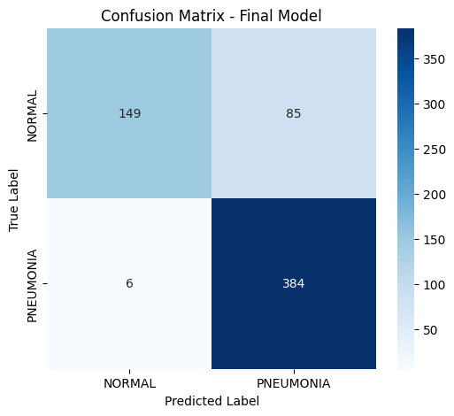
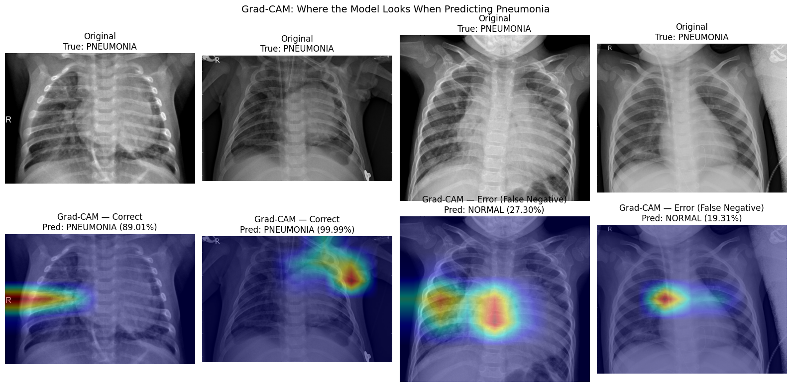

# Pneumonia Detection from Chest X-Ray Images

Team project (Deep Learning, Computer Vision, Medical Sector). The pipeline classifies chest X-rays as **NORMAL** or **PNEUMONIA**. It covers a full exploratory data analysis, five controlled training experiments, a final evaluation on a held-out test set, error analysis and Grad-CAM interpretability.

## Results

**Final model:** DenseNet121 transfer learning, evaluated on the original 624-image test set.

| Metric | Value |
|---|---|
| Test accuracy | 85.42% |
| ROC-AUC | 0.958 |
| Sensitivity (recall for PNEUMONIA) | **98.46%** (only 6 of 390 pneumonia cases missed) |
| Specificity (recall for NORMAL) | 63.68% |
| F1-score (PNEUMONIA) | 0.894 |

The model was tuned to rarely miss a pneumonia case, because a missed diagnosis is the most dangerous error. The trade-off is more false alarms on normal X-rays.



### The five experiments

| # | Experiment | Best validation accuracy |
|---|---|---|
| 1 | Baseline CNN, trained from scratch | 96.36% |
| 2 | DenseNet121, frozen backbone | 95.59% |
| 3 | DenseNet121, learning rate 1e-4 | 92.72% |
| 4 | DenseNet121, batch size 16 | 94.06% |
| 5 | **DenseNet121, deeper fine-tuning (last 100 layers)** | **96.65%** |

## Grad-CAM: where the model looks



## Dataset

[Chest X-Ray Images (Pneumonia), Kaggle](https://www.kaggle.com/datasets/paultimothymooney/chest-xray-pneumonia): 5,856 images, with roughly 2.7 pneumonia images for every normal one.

- The original `val` folder has only 16 images, so a **stratified 80/20 split** of the training data was used instead: 4,172 images for training and 1,044 for validation.
- The original 624-image test set was used **only** for the final evaluation.
- Class imbalance was handled with **class weights**. Data augmentation was applied to the training set only.
- The dataset is **not included** in this repository because it is about 1.2 GB.

## Repository structure

```
├── chest-eda.ipynb                         # exploratory data analysis
├── Chest_X_Ray_Improved_Model_v4.ipynb      # 5 experiments, evaluation, error analysis, Grad-CAM
├── src/                                     # script version of the pipeline
│   ├── data_preprocessing.py
│   ├── model.py
│   ├── train.py
│   └── evaluate.py
├── images/                                  # result figures
└── requirements.txt
```

The reported results come from `Chest_X_Ray_Improved_Model_v4.ipynb`. The scripts in `src/` are an earlier version of the pipeline that uses 150×150 input images; the notebook uses 224×224.

## Run it

**Notebook (recommended):** open `Chest_X_Ray_Improved_Model_v4.ipynb` in Google Colab with a GPU, upload your `kaggle.json` when prompted, and run all cells.

**Scripts:**
```bash
pip install -r requirements.txt
python src/train.py --data_dir /path/to/chest_xray --model both
python src/evaluate.py --model_path outputs/densenet_model.h5 --data_dir /path/to/chest_xray
```

## Tech stack

Python · TensorFlow / Keras · DenseNet121 · scikit-learn · NumPy · Pandas · Matplotlib · Seaborn · Google Colab

## Limitations and next steps

- Specificity (63.7%) is much lower than sensitivity. Tuning the decision threshold could balance the two.
- The EDA found **13 near-duplicate image pairs that appear in more than one data split**. These should be removed in a follow-up run.

> ⚠️ This is an academic project and is not a medical diagnostic tool.
